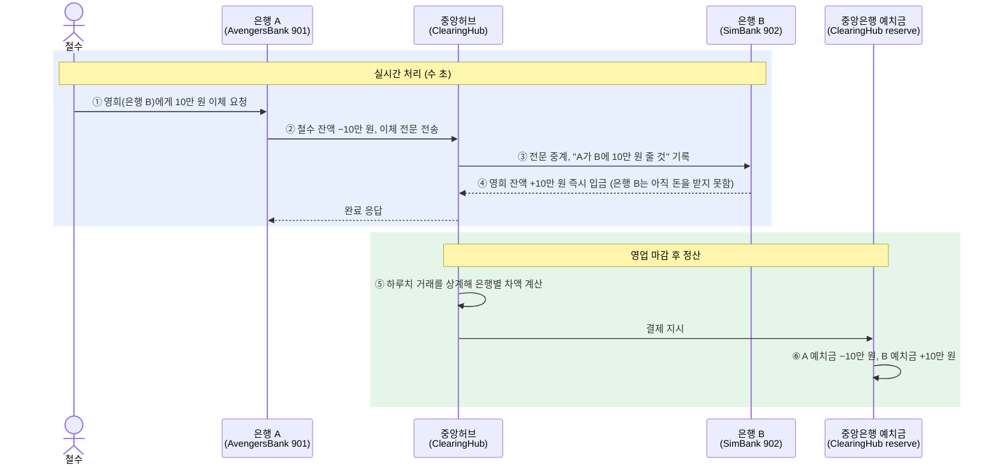

# ClearingHub

은행 간 이체 중계 서버: 참가 은행들이 허브 하나만 부르면 서로 이체할 수 있게 하고, 거래를 기록·추적·정산한다. FastAPI + SQLAlchemy(async) + PostgreSQL.

## 요약 (1분)

실제 금융망에서 **금융결제원(중계)** 과 **한국은행 당좌예금(정산)** 이 하는 일을 부트캠프 규모로 만든 서버다. 여러 팀이 따로 만든 은행 서버가 규격 하나만 지키면 서로 돈을 보낼 수 있고, 허브가 그 거래를 중계·기록하고 하루 단위로 정산한다.

**풀려는 문제**: 타은행 이체는 출금(보내는 은행 DB)과 입금(받는 은행 DB)이 서로 다른 DB에서 일어나 한 트랜잭션으로 묶을 수 없다. 중간에 끊기면 돈이 사라지거나 두 번 들어가고, 받는 은행이 "입금했다"고 답하는 것 말고는 증거가 없다.

| 문제 | 해결 | 코드 |
|---|---|---|
| 은행이 N개면 연동이 N×(N−1)개 | 모든 은행이 허브만 부른다. 연동 규격 문서 하나, 초대 코드로 셀프 등록 | [docs/SPEC.md](docs/SPEC.md), `domains/banks/` |
| 응답이 끊기면 돈이 사라지거나 두 번 들어간다 | `transfer_id` 멱등 + 상태 머신. 받는 은행이 5초 안에 답하지 않으면 `PENDING`으로 두고, 1분마다 최대 10회 결과를 확인한다 | `domains/transfers/`, `workers/retry.py` |
| 누가 보냈는지 모르고, 나중에 부인할 수 있다 | 요청과 응답 모두 Ed25519 서명. 허브는 은행의 개인키를 갖지 않고, 서명된 원문을 증거로 보관한다 | `core/signing.py`, `transfers/evidence.py` |
| 받는 은행이 먼저 내준 돈이 갚아지지 않는다 | 매일 00:05(KST)에 하루치 거래를 은행마다 차액 하나로 상계해 예치금 원장에서 옮긴다 | `domains/settlement/`, `domains/reserve/` |
| 갚을 수 없는 만큼 보낼 수 있다 | 접수할 때 `미정산 순채무 + 금액 > 예치금 + 한도`면 `LIMIT_EXCEEDED`로 거절 | `transfers/exposure.py` |
| 입금하지 않고 "완료"라고 답할 수 있다 | 은행이 허브 기록을 자기 장부와 대사해, 확정 전에 어긋난 거래를 찾아낸다 | `/v1/settlements`, [DEMO 8절](docs/DEMO.md) |

- **스택**: Python 3.13, FastAPI, SQLAlchemy(async), PostgreSQL, Alembic, httpx, Docker
- **검증**: pytest 346개 (SQLite로 돌아 PostgreSQL 없이 실행). 이체 성공·실패·멱등·타임아웃·재시도, 정산·대사, 부인방지, 시연 시나리오 전체
- **배포**: `main` push → GitHub Actions(테스트 → arm64 이미지 → ECR) → AWS EC2. 장기 액세스 키 없이 OIDC
- **연동한 은행**: [AvengersBank](https://github.com/jjh7757/avengers-bank)(901, 첫 참가 은행), SimBank(902, 이 저장소의 가짜 은행), Node.js 참고 구현([examples/node-bank](examples/node-bank))
- **바로 보기**: [API 문서](https://clearing-hub.ai-agent-develop.cloud/docs) · [SimBank 시연 화면](https://simbank.ai-agent-develop.cloud/)(조회·보내기는 시연 비밀번호 필요) · [시연 대본](docs/DEMO.md) · 로컬에서는 `uv run python -m clearing_hub.devserver` 한 줄 ([아래](#로컬에서-한-명령으로-postgresql-없이))

## 타은행 이체 흐름

실제 타은행 이체는 두 단계로 나뉜다. 고객 화면에서는 몇 초 만에 끝나지만, **은행 사이의 실제 돈은 영업 마감 뒤 중앙은행에서 차액만 한 번에 옮겨진다.** ClearingHub는 이 흐름에서 중앙허브(금융결제원)와 중앙은행 지급준비금 계좌의 역할을 맡는다.



| 단계 | 실제 금융망 | 이 저장소 |
|---|---|---|
| ① | 고객이 은행 A 앱에서 이체 요청 | 참가 은행의 화면 (AvengersBank 타행 이체, SimBank 보내기) |
| ② | 은행 A가 출금하고 중앙허브로 전문 전송 | 은행 → `POST /v1/transfers` (Ed25519 서명, `transfer_id`로 멱등). 허브가 순채무한도를 검사하고 `ACCEPTED` |
| ③ | 중앙허브가 은행 B로 중계하고 "A가 B에 줄 돈"을 기록 | 허브 → `POST /interbank/receive`, `transfers`·`transfer_events`에 기록 |
| ④ | 은행 B가 받는 고객에게 즉시 입금 | 받는 은행이 서명한 `COMPLETED` 응답. 응답이 없으면 `PENDING` → 재시도 태스크가 확인 |
| ⑤ | 중앙허브가 하루치를 상계해 차액을 계산하고 중앙은행에 결제 요청 | `workers/settlement.py`가 매일 00:05(KST)에 정산 DRAFT를 만든다 (다자간 차액, 합은 0). 은행은 `GET /v1/settlements/{run_id}`로 대사 |
| ⑥ | 중앙은행이 지급준비금 계좌에서 A → B로 옮겨 정산 완료 | 확정하면 `domains/reserve/`가 예치금 잔액을 옮기고 `reserve_ledger`에 분개를 남긴다 |

①~④에서 은행 B는 돈을 받지 않은 채 고객에게 먼저 내준다. 이 외상을 믿을 수 있게 하는 장치가 위 요약의 서명·순채무한도·대사다. 실제 돈은 움직이지 않고, ⑥은 허브 DB의 모의 예치금 숫자를 옮기는 데서 끝난다. 자세한 설계는 [docs/SETTLEMENT_PLAN.md](docs/SETTLEMENT_PLAN.md).

## 문서

| 문서 | 내용 |
|---|---|
| [docs/PROJECT_PLAN.md](docs/PROJECT_PLAN.md) | 계획서: 배경, 구조, 데이터 모델, 일정, 리스크 |
| [docs/SPEC.md](docs/SPEC.md) | **참가 은행 연동 규격** (다른 팀에 전달하는 문서) |
| [docs/DEPLOY.md](docs/DEPLOY.md) | AWS 배포: 처음 한 번 할 일, 가짜 은행 연결, 서버 `.env`, 정산 배포 순서(예치금), Ed25519 필수화 배포 순서 |
| [docs/ONBOARDING.md](docs/ONBOARDING.md) | 허브 관리자용: 새 팀에 초대 코드 보내기, 등록 확인, 예치금·키 문제, 문제가 생겼을 때 보는 곳, 401 문의 (연동 진단) |
| [docs/SETTLEMENT_PLAN.md](docs/SETTLEMENT_PLAN.md) | 정산 계획서: 예치금 원장, 순채무한도, 마감 상계, 대사, 확정, 부인방지(12절) |
| [docs/DEMO.md](docs/DEMO.md) | 시연 대본: 예치 → 한도 → 하루치 → 상계 → 대사 → 확정 → 속이는 은행 (curl과 기대 숫자) |
| [docs/SIMBANK_PLAN.md](docs/SIMBANK_PLAN.md) | SimBank(902) 시연 화면 계획: 잔액·거래내역·보내기 |

## 구조

```
src/clearing_hub/
├── main.py                 앱, 재시도·정산 태스크 시작
├── devserver.py            로컬 개발 서버: 허브 + 가짜 은행을 한 명령으로 (SQLite, 아래 "로컬에서 한 명령으로")
├── core/
│   ├── signing.py          Ed25519 요청 서명, 응답 서명, 키 쌍·지문, API 키·초대 코드 발급 (SPEC 2.2·2.3·2.5)
│   ├── auth.py             은행 인증(등록된 공개키로 Ed25519 검증, 이전 키 24시간), 관리자 토큰
│   ├── bank_client.py      허브 → 은행 호출 (허브 키로 서명, 응답 서명 검증 필수, 타임아웃)
│   ├── response_signing.py /v1 응답에 허브 응답 서명 (SPEC 2.5)
│   ├── signature_doctor.py 서명 진단기 (규칙): 실패한 서명을 흔한 실수 변형으로 다시 검증해 원인 가설 (SPEC 3.8)
│   ├── alerts.py           관리자 알림 웹훅 (ALERT_WEBHOOK_URL)
│   └── config.py, database.py, exceptions.py, exception_handlers.py, request_id.py
├── domains/
│   ├── banks/              참가 은행: 초대 코드 (/admin/invites), 셀프 등록 (/v1/banks/register), 내 정보·주소 변경·ping (/v1/me),
│   │                       관리자 등록·API 키 재발급·공개키 (/admin/banks), 목록 (/v1/banks), 허브 공개키 (/v1/hub-key), 키 회전 (/v1/keys)
│   ├── accounts/           본인 명의 계좌 조회 (/v1/accounts/lookup), account_ref, 조회 기록 (/admin/account-lookups)
│   ├── inquiry/            수취 조회 중계 (/v1/inquiry)
│   ├── reserve/            예치금 원장(모의 당좌예금): 내 예치금 (/v1/reserve), 입출금·정정·분개 (/admin/reserve)
│   ├── support/            연동 진단: 인증 실패 기록 (failures.py, auth_failures), 규칙 진단·401 hint
│   │                       (/v1/diagnose/failures — API 키만으로 식별, /admin/banks/{code}/auth-failures)
│   ├── settlement/         정산 배치: 미정산 거래 수집·다자간 차액·쌍별 표·취소·CSV, 확정(예치금 반영) (/admin/settlements), 은행용 대사 파일 (/v1/settlements)
│   └── transfers/          이체 접수(순채무한도 검사)·전달·상태 머신·결과 조회 (/v1/transfers), 관리 조회 (/admin/transfers),
│                           증거 원문 보관 (evidence.py, /admin/transfers/{id}/evidence)
└── workers/
    ├── retry.py            미확인(PENDING) 거래 확인 태스크
    └── settlement.py       일일 정산 배치 (매일 00:05 KST 어제 정산 DRAFT, 설정 시 자동 확정, 시작 때 놓친 배치 catch-up)
src/bank_sim/main.py        가짜 은행 (SPEC 4·9.4절 참고 구현, 계좌번호 끝자리로 성공·실패·지연·속임 재현, 허브 공개키 검증, 응답 서명)
examples/README.md          참고 구현 목록 (Python bank_sim, SPEC 빠른 시작, Node.js examples/node-bank)
tests/                      서명, 인증, 이체 성공·실패·멱등·타임아웃·재시도, 예치금·순채무한도·정산·대사 API,
                            시연 시나리오 전체 (test_demo_scenario.py = docs/DEMO.md), 부인방지 K1~K10 (test_nonrepudiation.py),
                            셀프 등록·기본 한도·/v1/me (test_onboarding.py), 서명 진단기 (test_signature_doctor.py), 연동 진단 API·401 hint (test_support.py)
```

이체 상태: `ACCEPTED → DELIVERING → COMPLETED / FAILED / PENDING → (재시도) → COMPLETED / FAILED / UNKNOWN`

## 시작하기

[uv](https://docs.astral.sh/uv/)와 PostgreSQL이 필요하다.

```bash
uv sync
cp .env.example .env
```

`.env`에 `DATABASE_URL`, `ADMIN_TOKEN`(32자 이상), `HUB_SIGNING_KEY`(**필수**, 허브 Ed25519 개인키)를 채운다. 키 쌍은 이렇게 만든다 (앞이 개인키, 뒤가 공개키):

```bash
uv run python -c "from clearing_hub.core.signing import generate_keypair; print(generate_keypair())"
```

```bash
uv run alembic revision --autogenerate -m "init"
```
```bash
uv run alembic upgrade head
```
```bash
uv run fastapi dev
```

API 문서: http://127.0.0.1:8000/docs

> Windows에서는 `uv run fastapi run`이 psycopg 비동기 모드와 맞지 않는다. 개발 중에는 `fastapi dev`를 쓴다.

## 로컬에서 한 명령으로 (PostgreSQL 없이)

다른 팀이 자기 은행 서버를 로컬 허브에 붙여 보거나, 허브를 고치며 손으로 확인할 때 쓴다. **개발 전용**이다.

```bash
uv sync
```
```bash
uv run python -m clearing_hub.devserver
```

- 허브 `http://127.0.0.1:8000`(API 문서 `/docs`)과 가짜 은행 `902` `http://127.0.0.1:8100/interbank`가 한 프로세스로 함께 뜬다. 종료는 Ctrl+C. 포트는 `--hub-port`·`--sim-port`로 바꾼다
- 처음 실행하면 관리자 토큰·허브 키·가짜 은행 키를 만들어 **`.env.dev`**(현재 폴더)에 저장하고 다음부터 다시 쓴다. DB는 **`dev_hub.db`**(SQLite). 둘 다 `.gitignore`에 있다. 처음부터 다시 하려면 `dev_hub.db`를 지운다
- 시작할 때 `902`가 없으면 등록하고 예치금 1,000만 원을 넣은 뒤, **새 초대 코드를 만들어 초대 문구를 콘솔에 출력**한다 (관리자 토큰, 허브 주소, 초대 코드, 허브 공개키·지문). 이것으로 [SPEC "빠른 시작"](docs/SPEC.md)을 그대로 따라 한다
- 내 은행의 `base_url`은 `http://127.0.0.1:3000/interbank`처럼 http로 등록해도 된다 (허브는 `base_url`의 https를 강제하지 않는다. 운영 허브에는 SPEC 3.5대로 공개 HTTPS)
- 초대 코드가 더 필요하면: `curl -X POST http://127.0.0.1:8000/admin/invites -H "X-Admin-Token: <콘솔의 토큰>"`
- SimBank 시연 화면: `SIM_UI_PASSWORD=<아무 값>`을 주고 띄우면 `http://127.0.0.1:8100/`에서 고객 잔액·거래내역·보내기를 쓴다 (`GET /health`가 예전 JSON). `--peer-port 8111`을 붙이면 보낼 상대 은행 903 PeerBank도 함께 뜬다

운영과 다른 점: 테이블을 Alembic이 아니라 `Base.metadata.create_all`로 만든다(Alembic의 FK 추가가 SQLite에서 되지 않는다), 정산 일일 배치(`SETTLEMENT_WORKER_ENABLED=false`)와 알림 웹훅이 꺼져 있다. 환경 변수에 이미 있는 값(`DATABASE_URL` 등)이 `.env.dev`보다 먼저다.

## 가짜 은행과 함께 돌려 보기 (PostgreSQL, 따로 띄우기)

1. 가짜 은행 키 쌍을 만들고(위 명령), 공개키로 902를 등록한다 (관리 API, `X-Admin-Token` 헤더):
   ```bash
   curl -s -X POST http://127.0.0.1:8000/admin/banks -H "X-Admin-Token: <ADMIN_TOKEN>" -H "Content-Type: application/json" -d "{\"bank_code\":\"902\",\"name\":\"SimBank\",\"base_url\":\"http://127.0.0.1:8100/interbank\",\"public_key\":\"<가짜 은행 공개키>\"}"
   ```
2. 가짜 은행을 켠다. 자기 개인키로 응답에 서명하고, 허브 공개키(`GET /v1/hub-key`의 `public_key`)로 허브 서명을 검증한다:
   ```bash
   SIM_SIGNING_KEY=<가짜 은행 개인키> SIM_HUB_PUBLIC_KEY=<허브 공개키> uv run uvicorn bank_sim.main:app --port 8100
   ```
   `POST /admin/banks/902/ping`이 `"ok": true`면 된다.
3. 보내는 은행(예: `901`)은 초대 코드로 셀프 등록한다: `POST /admin/invites` → 은행이 자기 키 쌍을 만들어 `POST /v1/banks/register {"invite_code","name","base_url","public_key"}` → 응답의 `bank_code`·`api_key`로, 자기 개인키로 서명해 `/v1/transfers`를 부른다. 서명 방법과 예시는 [SPEC.md](docs/SPEC.md) 2절, 절차는 7절과 [docs/ONBOARDING.md](docs/ONBOARDING.md).
   새 은행은 예치금 0, 순채무한도 기본 10억이라 바로 보낼 수 있다 (SPEC 10.2).
4. 정산까지 이어서 보려면 [docs/DEMO.md](docs/DEMO.md)의 순서대로 한다.

가짜 은행의 계좌번호 끝 4자리: `0001` 정상 · `0002` 계좌 없음 · `0003` 지연(타임아웃) · `0004` 500 두 번 뒤 성공 · `0005` 입금됐는데 응답 없음 · `0006` 입금하지 않고 `200 COMPLETED` (대사 시연용. 허브는 이 거래를 `COMPLETED`로 기록하지만 가짜 은행 장부에는 없다).

본인 계좌 조회(SPEC 9절): 가짜 은행은 `김철수 / 19850315 / 01098765432`의 가상 CI(`SIM_CI_KEY`, 기본 `example-ci-key-change-me`)에 계좌 2개, `홍길동 / 19900101 / 01000000000`(AvengersBank 시연 고객)에 1개를 돌려준다.

## 테스트

```bash
uv run pytest
```

SQLite로 돌아가 PostgreSQL 없이 실행된다. 허브 → 은행 호출은 같은 프로세스의 가짜 은행 앱으로 보낸다.

## 배포

`main`에 push하면 GitHub Actions가 테스트 → arm64 이미지 → ECR → 공용 서버 배포까지 한다. 허브와 가짜 은행이 같은 이미지로 컨테이너 두 개로 뜬다. 처음 한 번 할 일은 [docs/DEPLOY.md](docs/DEPLOY.md).

## 로그

허브와 가짜 은행 모두 한 줄에 JSON 하나로 남기고, 모든 줄에 추적 ID `request_id`가 붙는다 ([SPEC 2.4](docs/SPEC.md)).
요청마다 접근 로그 한 줄(`clearing_hub.access`: 메서드, 경로, 상태, 걸린 시간, 요청한 은행 코드)이 남고,
재시도 태스크의 로그에는 그 거래를 처음 접수할 때의 ID가 붙는다. 보내는 은행이 준 ID로 세 서버를 이어 찾는다.

```bash
docker logs clearing-hub 2>&1 | grep <request_id>
```

`LOG_LEVEL`(기본 `INFO`), `LOG_FORMAT`(`json` 기본 / `text`: 로컬에서 읽기 편한 형식)으로 바꾼다.

## 다음 단계

- 관리자 JWT 로그인 (지금은 `ADMIN_TOKEN` 헤더)
- 정산(마감 상계 → 대사 → 예치금 결제): [docs/SETTLEMENT_PLAN.md](docs/SETTLEMENT_PLAN.md) 1~7단계 완료 — 예치금 원장(`reserve/`), 순채무한도(접수 때 `LIMIT_EXCEEDED`, `transfers/exposure.py`), 정산 DRAFT·확정·일일 워커(`settlement/`, `workers/settlement.py`), 은행용 대사 API(SPEC 10절), AvengersBank 대사·장부 정리, 시연([docs/DEMO.md](docs/DEMO.md))
- 부인방지(계획서 12절, SPEC v1.0): 8a~8d 완료 — 서명은 Ed25519 하나(HMAC 삭제, 허브는 은행 비밀을 갖지 않는다), 응답 서명 필수, 키 회전 24시간, 증거 원문 보관(`transfer_evidence`), 초대 코드 셀프 등록·`/v1/me`·기본 한도 10억
- 9단계(계획서 13절, SPEC v1.1) 완료: 정산 자동 확정(은행 ack/dispute, 전원 ack 즉시·09:00 KST 마감), 은행 셀프 시험(`POST /v1/test-receive`), 알림 웹훅(`ALERT_WEBHOOK_URL`). 관리자 일은 [docs/ONBOARDING.md](docs/ONBOARDING.md)
- 관리 사이트(React)
